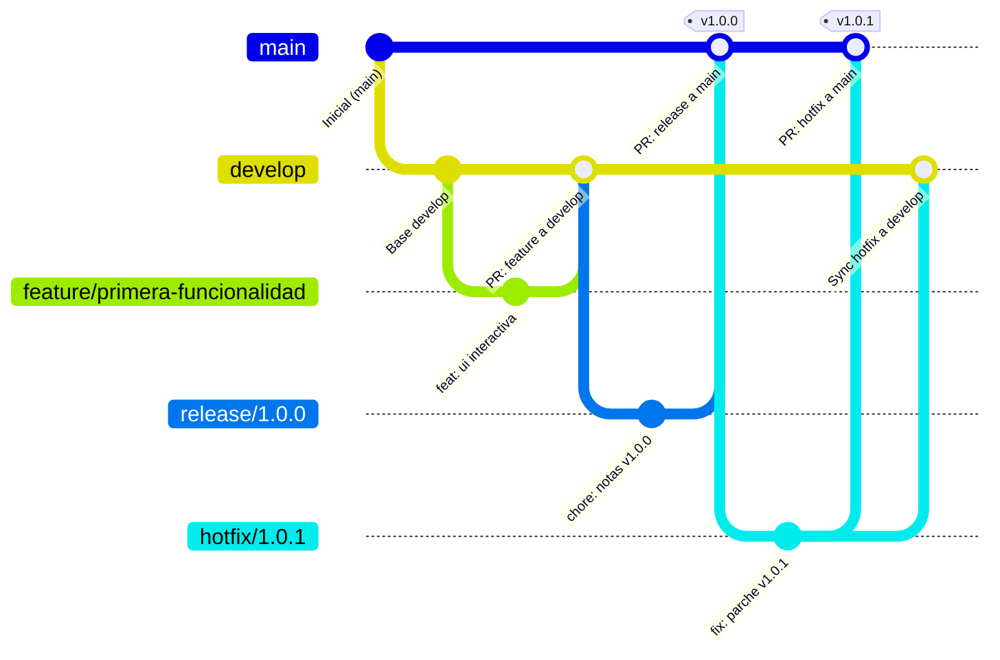

# Práctica 1 — Implementación de Git Flow y GitHub Actions

**Asignatura:** Desarrollo y Ciclo de Vida de Software / Flujos de Trabajo  
**Estudiante:** Luis Ramón Pérez Álvarez  
**Repositorio Remoto:** [https://github.com/LuisRamonPerezAlvarez/Flujos_de_trabajo](https://github.com/LuisRamonPerezAlvarez/Flujos_de_trabajo)  
**Fecha de Elaboración:** Octubre 2026  

---

## 1. Objetivo de la Práctica

El propósito de esta práctica es implementar de manera rigurosa y práctica:
1. El modelo de ramificación profesional **Git Flow**, organizando el ciclo de vida del código en ramas principales (`main`, `develop`), ramas de soporte (`feature`, `release`, `hotfix`) y una rama de artefactos (`build`).
2. La automatización de compilación y despliegue continuo (**CI/CD**) mediante **GitHub Actions**, garantizando que cada cambio integrado en `main` se compile de manera determinista y publique sus binarios/estáticos generados (`dist`) en una rama aislada (`build`).
3. La configuración de políticas de gobernanza y protección de ramas mediante un **Ruleset** en GitHub, salvaguardando la integridad de `main` contra borrados accidentales, force-pushes y fusiones no supervisadas.

---

## 2. Descripción del Repositorio y Arquitectura Técnica

El proyecto consiste en una aplicación web interactiva desarrollada con **Vite** y **React**, configurada para documentar y visualizar en tiempo real el estado del flujo de ramificación y del pipeline de CI/CD.

- **Tecnologías utilizadas:**
  - **Node.js**: v22.13.0 (entorno de desarrollo local) / Node.js 20.x (entorno de ejecución en runner de GitHub Actions).
  - **Framework frontend**: React 18.3.1.
  - **Herramienta de empaquetado (Bundler)**: Vite 5.4.11 / 5.4.21.
  - **Gestor de dependencias**: `npm` con archivo de bloqueo determinista `package-lock.json`.
  - **CI/CD**: GitHub Actions con runner `ubuntu-latest`.

### Estructura del Proyecto

```text
Flujos de trabajo/
├── .github/
│   └── workflows/
│       └── deploy.yml              # Pipeline de CI/CD para GitHub Actions
├── docs/
│   └── Practica_1_Flujo_Git_Flow.md # Documento de entrega y memoria técnica
├── src/
│   ├── App.jsx                     # Componente principal con selector de ramas interactivo
│   ├── index.css                   # Hoja de estilos con diseño moderno oscuro
│   └── main.jsx                    # Punto de entrada de React
├── .gitignore                      # Exclusión de node_modules, dist, logs, etc.
├── index.html                      # Documento HTML base
├── package.json                    # Manifiesto del proyecto y scripts de compilación
├── package-lock.json               # Árbol de dependencias bloqueado para npm ci
├── RELEASE_NOTES.md                # Notas de versión generadas en la rama release
└── vite.config.js                  # Configuración de Vite con ruta relativa base ('./')
```

---

## 3. Modelo de Ramas (Git Flow)

Se configuraron e implementaron las ramas requeridas por el estándar Git Flow:

| Rama | Tipo | Rama Base | Propósito |
| :--- | :--- | :--- | :--- |
| `main` | Principal / Permanente | — | Contiene el código estable y probado en producción. Está protegida y solo recibe cambios mediante Pull Requests validados. |
| `develop` | Principal / Permanente | `main` | Rama de integración para el trabajo continuo del equipo. Sirve de tronco central antes de congelar versiones de entrega. |
| `feature/primera-funcionalidad` | Soporte / Temporal | `develop` | Utilizada para desarrollar una funcionalidad específica (componente interactivo de inspección de ramas). |
| `release/1.0.0` | Soporte / Temporal | `develop` | Utilizada para estabilizar la versión 1.0.0, congelar código y redactar notas de lanzamiento antes de enviar a `main`. |
| `hotfix/1.0.1` | Soporte / Temporal | `main` | Utilizada para resolver incidencias críticas y urgentes directamente sobre el código de producción sin esperar al ciclo de `develop`. |
| `build` | Artefactos / Automatizada | Generada por CI/CD | Rama huérfana/independiente que contiene exclusivamente los archivos compilados en la carpeta `dist`. |

> **Nota sobre nomenclatura (`dev` vs. `develop`):**  
> En el estándar original de Vincent Driessen (*A successful Git branching model*), el nombre canónico es `develop`. En algunos entornos ágiles y rúbricas universitarias se abrevia como `dev`. Ambas representan el mismo rol arquitectónico; en esta práctica se adoptó la convención canónica `develop` para máxima compatibilidad con las herramientas de Git Flow.

---

## 4. Diagrama del Flujo de Trabajo

El siguiente diagrama ilustra la interacción entre las ramas, los puntos de bifurcación y la activación del workflow de despliegue hacia la rama `build`:



### Flujo del Pipeline de GitHub Actions

```mermaid
flowchart LR
    A[Push o Merge a 'main'] --> B[GitHub Actions Runner: ubuntu-latest]
    B --> C[actions/checkout@v4]
    C --> D[actions/setup-node@v4: Node.js 20]
    D --> E[npm ci: Instalación limpia]
    E --> F[npm run build: Generación de dist/]
    F --> G[s0/git-publish-subdir-action]
    G --> H[Rama remota 'build' actualizada]
```

---

## 5. Historial Real de Commits y Operaciones Git

A diferencia de simulaciones teóricas, cada una de las ramas fue creada a partir de su rama base correspondiente y publicada en el servidor remoto de GitHub:

1. **Commit en `main` (`290ed12`):**  
   - Mensaje: `feat: estructura inicial del proyecto con Vite, React y GitHub Actions`  
   - Base del repositorio remoto y punto de partida de todo el historial.
2. **Creación de `develop`:**  
   - Bifurcada desde `main`. Publicada como `origin/develop`.
3. **Commit en `feature/primera-funcionalidad` (`3e74d55`):**  
   - Bifurcada desde `develop`.  
   - Mensaje: `feat(ui): agregar componente interactivo de inspección de ramas`  
   - Modificación: Se implementó un panel con botones dinámicos para explorar el propósito de cada rama y un contador de interacciones en `src/App.jsx`.
4. **Commit en `release/1.0.0` (`2379cba`):**  
   - Bifurcada desde `develop`.  
   - Mensaje: `chore(release): preparar versión 1.0.0 e incluir notas de versión`  
   - Archivo añadido: `RELEASE_NOTES.md`.
5. **Commit en `hotfix/1.0.1` (`13ba820`):**  
   - Bifurcada directamente desde `main`.  
   - Mensaje: `fix(patch): corrección urgente e incremento de versión a 1.0.1`  
   - Modificación: Incremento de versión en `package.json` a `1.0.1`.
6. **Ejecución y generación de la rama `build` (`9dc1b27`):**  
   - Generada automáticamente por GitHub Actions.  
   - Mensaje del bot: `Update build to output generated at 290ed12`.  
   - Archivos presentes: Únicamente `index.html` y el directorio `assets/` (sin código fuente).

---

## 6. Configuración y Funcionamiento de GitHub Actions

El flujo de trabajo se encuentra en `.github/workflows/deploy.yml`. Cumple con todos los estándares modernos de GitHub Actions:

```yaml
name: Deploy Build Artifacts

on:
  push:
    branches:
      - main

permissions:
  contents: write

jobs:
  build-and-deploy:
    runs-on: ubuntu-latest

    steps:
      - name: Descargar repositorio
        uses: actions/checkout@v4
        with:
          fetch-depth: 0

      - name: Configurar Node.js 20
        uses: actions/setup-node@v4
        with:
          node-version: 20

      - name: Instalar dependencias
        run: npm ci

      - name: Compilar proyecto
        run: npm run build

      - name: Publicar dist en la rama build
        uses: s0/git-publish-subdir-action@develop
        env:
          REPO: self
          BRANCH: build
          FOLDER: dist
          GITHUB_TOKEN: ${{ secrets.GITHUB_TOKEN }}
```

### Características Técnicas del Pipeline:
- **Disparador selectivo:** Se ejecuta exclusivamente ante eventos de `push` (directo o por merge) sobre `main`, impidiendo bucles infinitos en otras ramas.
- **Seguridad y Permisos:** Incluye `permissions: contents: write` a nivel de workflow para habilitar la escritura en el repositorio usando el token temporal `${{ secrets.GITHUB_TOKEN }}` sin exponer claves privadas.
- **Determinismo:** El paso `npm ci` garantiza que las dependencias se instalen de forma idéntica a las registradas en `package-lock.json`.
- **Aislamiento de artefactos:** La acción `s0/git-publish-subdir-action@develop` toma únicamente la carpeta `dist/` resultante del empaquetado de Vite y realiza un commit sobre la rama `build`.

### Permisos Requeridos en GitHub (Configuración Web)
Para que el token automático `${{ secrets.GITHUB_TOKEN }}` pueda crear y actualizar ramas, se debe verificar en GitHub:
1. Ir a la pestaña **Settings** del repositorio.
2. En el menú lateral izquierdo, seleccionar **Actions** → **General**.
3. Desplazarse hasta la sección **Workflow permissions**.
4. Seleccionar la opción **Read and write permissions**.
5. Hacer clic en **Save**.

---

## 7. Protección de la Rama `main` (Ruleset)

Para evitar modificaciones no autorizadas o accidentales en la rama principal, se definen las siguientes especificaciones para el **Ruleset**:

### Procedimiento de Configuración en GitHub:
1. En el repositorio de GitHub, hacer clic en **Settings**.
2. En el panel lateral izquierdo, localizar la sección **Rules** y seleccionar **Rulesets**.
3. Hacer clic en el botón verde **New ruleset** → **New branch ruleset**.
4. Diligenciar los siguientes campos:
   - **Ruleset Name:** `Push validation`
   - **Enforcement status:** Cambiar de *Disabled* a **Active**.
5. En la sección **Target branches**:
   - Clic en **Add target** → **Include default branch** (o elegir *Include by pattern* e ingresar `main`).
6. En la sección **Branch rules**, habilitar las siguientes casillas:
   - ✅ **Restrict deletions:** Impide que cualquier usuario borre la rama `main`.
   - ✅ **Block force pushes:** Impide la reescritura del historial mediante `git push --force`.
   - ✅ **Require a pull request before merging:**
     - Establecer *Required approvals* en `0` (para permitir la práctica individual) o `1` (si se cuenta con revisores).
     - Marcar *Dismiss stale pull request approvals when new commits are pushed*.
7. Hacer clic en el botón inferior **Save changes** (o **Create**).

---

## 8. Procedimiento de Pull Requests para Completar la Integración

Dado que las ramas ya están publicadas en GitHub, los Pull Requests deben crearse y fusionarse a través de la interfaz web mediante los siguientes enlaces directos:

### Paso 1: Pull Request de la Funcionalidad hacia `develop`
- **Enlace directo:**  
  [Crear Pull Request feature -> develop](https://github.com/LuisRamonPerezAlvarez/Flujos_de_trabajo/compare/develop...feature/primera-funcionalidad?expand=1)
- **Rama base:** `develop`
- **Rama a comparar (compare):** `feature/primera-funcionalidad`
- **Título sugerido:** `feat(ui): integración de primera funcionalidad interactiva`
- **Acción:** Hacer clic en **Create pull request** y posteriormente en **Merge pull request** → **Confirm merge**.

### Paso 2: Pull Request de Integración hacia `main`
- **Enlace directo:**  
  [Crear Pull Request develop -> main](https://github.com/LuisRamonPerezAlvarez/Flujos_de_trabajo/compare/main...develop?expand=1)
- **Rama base:** `main`
- **Rama a comparar (compare):** `develop`
- **Título sugerido:** `release: integración de develop hacia main`
- **Acción:** Hacer clic en **Create pull request** y posteriormente en **Merge pull request** → **Confirm merge**.
- **Resultado esperado:** Inmediatamente tras fusionar este PR en `main`, GitHub Actions iniciará una nueva ejecución del workflow `Deploy Build Artifacts`, compilará la versión con la nueva funcionalidad y actualizará la rama `build`.

---

## 9. Comandos Principales Utilizados

| Fase | Comando | Propósito |
| :--- | :--- | :--- |
| **Clonación e inicialización** | `git clone https://github.com/LuisRamonPerezAlvarez/Flujos_de_trabajo.git .` | Clonar el repositorio remoto en la carpeta de trabajo |
| **Validación de dependencias** | `npm.cmd ci` | Verificar instalación estricta y limpia según `package-lock.json` |
| **Prueba de compilación** | `npm.cmd run build` | Validar que Vite genere la carpeta `dist` sin errores |
| **Creación de ramas** | `git checkout -b develop` | Crear la rama `develop` a partir de `main` |
| | `git checkout -b feature/primera-funcionalidad` | Crear la rama de funcionalidad a partir de `develop` |
| | `git checkout -b release/1.0.0` | Crear la rama de release a partir de `develop` |
| | `git checkout -b hotfix/1.0.1` | Crear la rama de hotfix directamente a partir de `main` |
| **Confirmación de cambios** | `git add .`<br>`git commit -m "..."` | Registrar cambios en el historial con mensajes semánticos |
| **Publicación remota** | `git push -u origin <nombre-de-rama>` | Enviar la rama y configurar el rastreo en GitHub |
| **Inspección de ramas** | `git branch -a` | Listar todas las ramas locales y remotas |
| **Inspección de artefactos** | `git fetch origin build`<br>`git ls-tree origin/build` | Comprobar que la rama generada por CI contiene solo archivos de `dist/` |

---

## 10. Lista de Comprobación de Evidencias (Screenshots a Capturar)

Para la entrega formal de la práctica, se deben tomar las siguientes capturas de pantalla en GitHub:

- [ ] **1. Enlace y vista general del repositorio:**
  - **URL:** `https://github.com/LuisRamonPerezAlvarez/Flujos_de_trabajo`
  - **Qué debe verse:** El nombre del repositorio, la rama por defecto, el README o archivos del proyecto y el último commit.
- [ ] **2. Lista de ramas creadas en GitHub:**
  - **URL:** `https://github.com/LuisRamonPerezAlvarez/Flujos_de_trabajo/branches`
  - **Qué debe verse:** El listado completo que incluye `main`, `develop`, `feature/primera-funcionalidad`, `release/1.0.0`, `hotfix/1.0.1` y la rama automatizada `build`.
- [ ] **3. Historial de commits (Network / Commits):**
  - **URL:** `https://github.com/LuisRamonPerezAlvarez/Flujos_de_trabajo/commits/main` y `https://github.com/LuisRamonPerezAlvarez/Flujos_de_trabajo/network`
  - **Qué debe verse:** Los commits con sus mensajes descriptivos en español y la visualización gráfica de las bifurcaciones.
- [ ] **4. Ruleset de protección de `main`:**
  - **URL:** `https://github.com/LuisRamonPerezAlvarez/Flujos_de_trabajo/settings/rules`
  - **Qué debe verse:** El ruleset `Push validation` en estado **Active**, aplicando sobre `main` las restricciones de borrado, bloqueo de force push y requerimiento de Pull Request.
- [ ] **5. Pull Requests (Abiertos o Fusionados):**
  - **URL:** `https://github.com/LuisRamonPerezAlvarez/Flujos_de_trabajo/pulls?q=is%3Apr`
  - **Qué debe verse:** El PR de `feature/primera-funcionalidad` hacia `develop` y el PR de `develop` hacia `main` (con el distintivo morado *Merged*).
- [ ] **6. Ejecución del workflow de GitHub Actions:**
  - **URL:** `https://github.com/LuisRamonPerezAlvarez/Flujos_de_trabajo/actions`
  - **Qué debe verse:** El workflow `Deploy Build Artifacts` con un check verde de éxito (**green check**), mostrando los pasos `npm ci`, `npm run build` y `Publish dist to build branch`.
- [ ] **7. Contenido de la rama `build`:**
  - **URL:** `https://github.com/LuisRamonPerezAlvarez/Flujos_de_trabajo/tree/build`
  - **Qué debe verse:** Únicamente `index.html` y la carpeta `assets/`, confirmando que el código fuente no se mezcló con los archivos compilados.

---

## 11. Conclusiones

La implementación de Git Flow junto con GitHub Actions permite desacoplar de forma limpia el desarrollo de nuevas características (`feature/*`), el aseguramiento y estabilización de versiones (`release/*`), la resolución inmediata de incidentes productivos (`hotfix/*`) y la entrega automatizada de artefactos en `build`. 

El uso de un Ruleset sobre `main` garantiza que ningún código llegue a producción sin pasar por revisión de Pull Request y sin validar la compilación exitosa en el entorno de integración continua.
